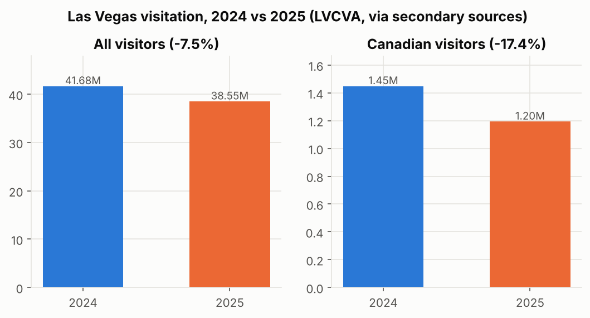
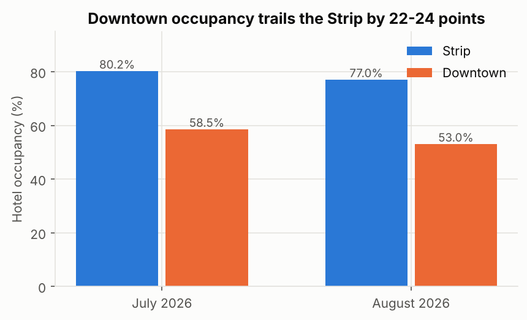
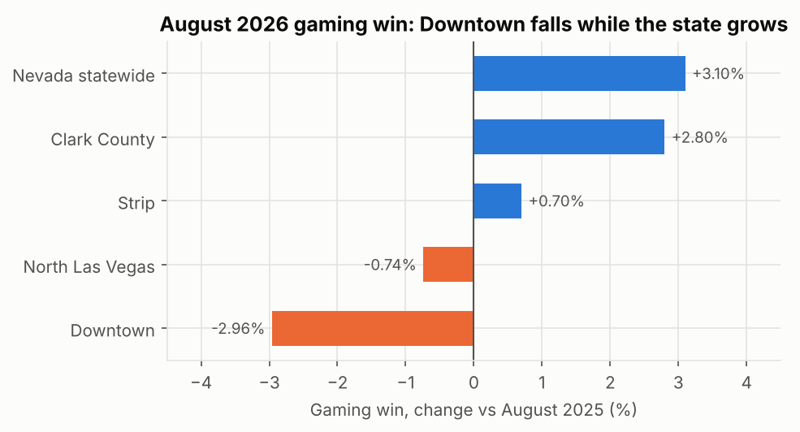

# Phase 1 (mock): Identifying Potential Issues

**Organization:** Las Vegas lodging market as represented by the LVCVA (destination marketing organization), with Downtown hotels as the business unit of focus.
**Data:** published LVCVA, Gaming Control Board, airport, Statistics Canada and NTTO figures (`data/curated/`), plus 504 TripAdvisor reviews (UCI). Every number below cites its source in the curated file.

## 1. Business context

Las Vegas depends on leisure and convention visitors who fly or drive in, stay in large casino hotels and spend on rooms, gaming, food and shows. 2025 was the weakest year since the pandemic recovery, and 2026 has not clearly recovered.

## 2. Identified issues

Each issue follows the chain: data used, metric, result, why it matters, limit.

### Issue 1. Visitation fell in 2025 and has not recovered (Critical)

- **Data / metric:** LVCVA annual and monthly visitor volume.
- **Evidence:** 38.5M visitors in 2025, down 7.5% from 41.7M; citywide RevPAR USD 147.30 (-8.8%). January-July 2026 was only 0.5% above 2025, and August 2026 fell 4.3% (RevPAR -11.5%).
- **Limit:** part of the August drop is calendar timing (Labor Day moved to September); monthly comparisons need calendar adjustment.

### Issue 2. Downtown is falling behind the Strip (Critical)

- **Evidence:** Downtown occupancy 58.5% in July 2026 (-4.5 points) and 53.0% in August, against 80.2% and 77.0% on the Strip. Downtown gaming win fell 2.96% in August 2026 while the Strip rose 0.7% and the state rose 3.1%.
- **Limit:** the Downtown hotel figures come from one news source each month; they must be checked against the LVCVA PDF.

### Issue 3. Price perception (Moderate)

- **Evidence:** 46% of Nevadans in an October 2025 poll (n = 766) said Las Vegas has become too expensive to visit; MGM's CEO publicly acknowledged pricing mistakes. In 2015 TripAdvisor data, budget hotels scored lowest (Circus Circus 3.21 of 5).
- **Limit:** the poll covers residents, not visitors, and the review data predates the decline.

### Issue 4. Loss of Canadian visitors (Exploratory)

- **Evidence:** Canadian visitors to Las Vegas fell 17.4% in 2025 (1.45M to 1.20M). Canadian trips to the US have grown year over year since April 2026 (August +8.8%).
- **Why exploratory:** a cause of the 2025 drop that is now reversing; Las Vegas-specific 2026 Canadian figures are not yet available.

## 3. Categorization

| Issue | Category | Justification |
|---|---|---|
| Stalled visitation | Critical | largest revenue effect, still under way in August 2026 |
| Downtown gap | Critical | clearest decline still worsening; two independent indicators (hotels, gaming) agree |
| Price perception | Moderate | plausible driver but evidence is indirect |
| Canadian market | Exploratory | reversing; needs 2026 Las Vegas data |

## 4. What data would be needed next

Monthly LVCVA tables 2015-2026, NGCB monthly win by area, and recent review text (Inside Airbnb or a sample of hotel reviews).
