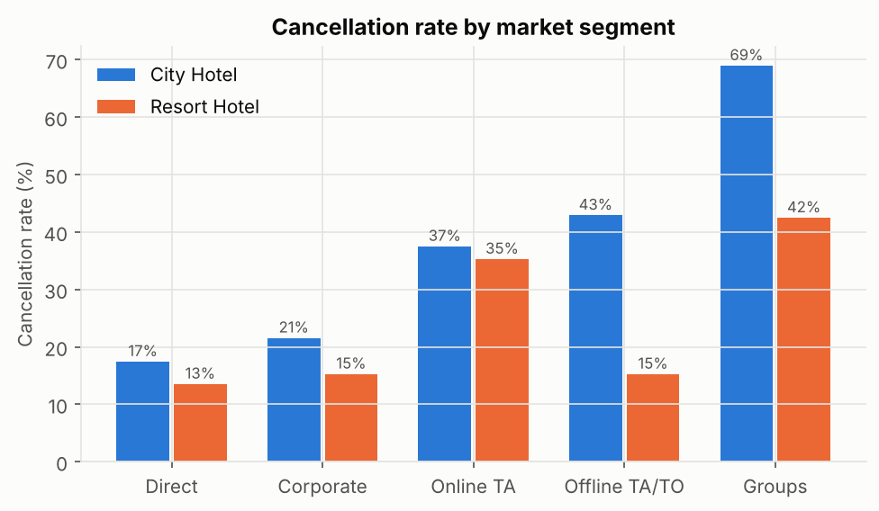
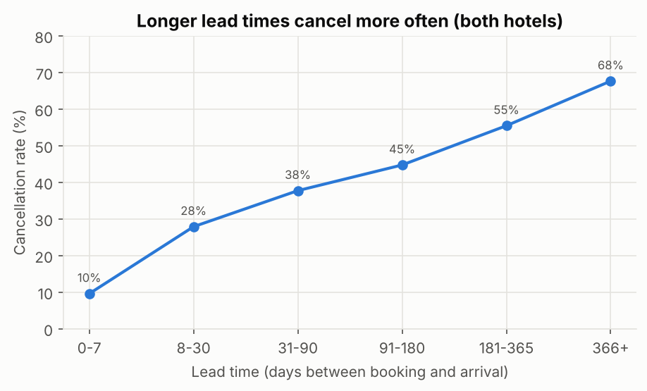
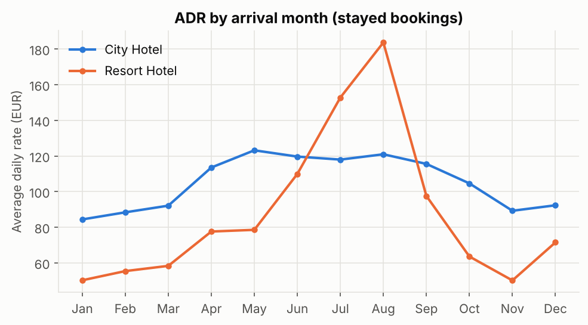

# Phase 1 (mock): Identifying Potential Issues

**Organization:** owner group of two Portuguese hotels, a 4-star-class City Hotel in Lisbon and a Resort Hotel in the Algarve.
**Industry:** hospitality (lodging).
**Data:** 119,206 bookings with arrivals from July 2015 to August 2017 (cleaned from 119,390; see `data_quality.md`).

## 1. Business context

The group sells rooms through online travel agents (47% of bookings), tour operators, group contracts and direct channels. Most bookings are made weeks or months ahead and carry no deposit, so a cancelled booking frees a room that may or may not be resold. The analysis below uses only booking records; no room inventory, cost or review data is available.

## 2. Identified issues

Each issue follows the same chain: data used, metric, result, why it matters.

### Issue 1. Cancellations put a large share of booked revenue at risk (Critical)

- **Data / metric:** `is_canceled` and booked value (`adr` x `nights`) per hotel.
- **Evidence:** the City Hotel cancelled 41.8% of bookings, worth EUR 10.9M or 43.1% of its booked value. The Resort Hotel cancelled 27.8%, worth EUR 5.8M or 33.5%.
- **Impact:** every cancellation that is not resold is lost room revenue and makes forecasting and staffing harder.
- **Limit:** booked value is an upper bound on the loss, because part of the cancelled nights were resold. The data cannot say how many.

### Issue 2. Group and travel-agent channels cancel far more than direct bookings (Critical)

- **Data / metric:** cancellation rate by `market_segment`.
- **Evidence (City Hotel):** Groups 68.9%, Offline TA/TO 42.9%, Online TA 37.5%, Corporate 21.5%, Direct 17.4%. The Resort Hotel shows the same order, at lower levels (Groups 42.4%, Online TA 35.2%, Direct 13.5%).
- **Impact:** the channel that brings the most bookings (Online TA, 49% at the City Hotel) also brings about twice the cancellation rate of direct bookings.

### Issue 3. Cancellation risk rises with lead time (Moderate)

- **Evidence:** bookings made 0-7 days ahead cancel 9.6% of the time; 91-180 days 44.7%; more than a year ahead 67.7%.
- **Why moderate:** lead time is a risk signal rather than a problem on its own, but it shows where a policy (deposit, reconfirmation) could be targeted.

### Issue 4. Strong seasonality in price, especially at the resort (Moderate)

- **Evidence:** paid ADR at the Resort Hotel ranges from EUR 50 in January and November to EUR 184 in August (3.7x). The City Hotel ranges from EUR 84 (January) to EUR 123 (May).
- **Why moderate:** seasonality is expected in leisure hotels. The open question is whether off-season demand is under-priced or simply weak, which needs the Phase 4 analysis.

### Issue 5. Very few repeat guests (Exploratory)

- **Evidence:** 3.2% of bookings come from repeat guests, who cancel far less (see Phase 4).
- **Why exploratory:** the data has no guest ID or loyalty information, so we cannot tell whether this is low loyalty or a data-capture gap.

## 3. Categorization

| Issue | Category | Justification |
|---|---|---|
| Cancellations and revenue at risk | Critical | 43% of City Hotel booked value is cancelled; direct revenue effect |
| Channel mix | Critical | largest channels carry the highest cancellation rates; actionable through contracts and pricing |
| Lead time | Moderate | strong signal, but a driver of Issue 1 rather than a separate loss |
| Seasonal pricing | Moderate | large swings, but partly normal for leisure demand |
| Repeat guests | Exploratory | small share; data cannot confirm the cause |

## 4. Data quality note

`deposit_type = Non Refund` bookings cancel 99.4% of the time (14,586 bookings; 97% Portuguese, 63% Groups). Real non-refundable bookings should rarely cancel, so these are most likely tour-operator block bookings coded as non-refundable. They are kept but flagged, and every result is checked with and without them.

## 5. Next steps

Phase 2 turns Issues 1-3 into research questions on cancellation drivers, revenue at risk and a targeted policy; Issue 4 becomes a pricing question.
