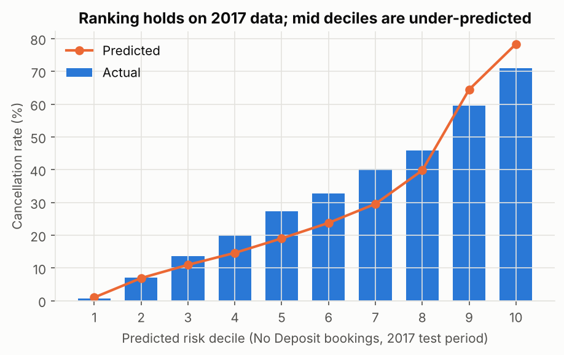
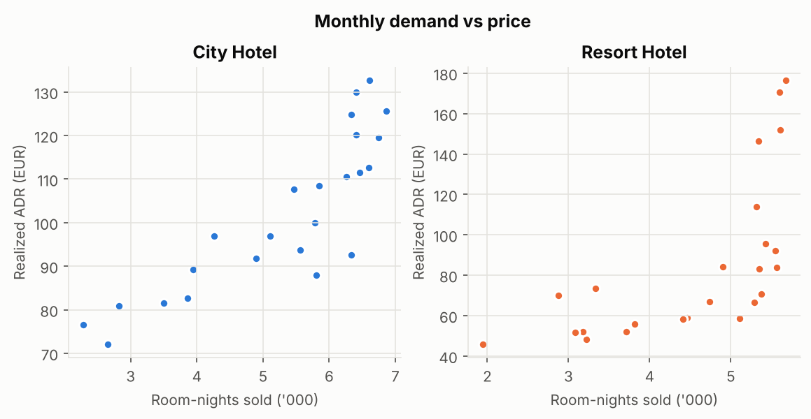

# Phase 4 (mock): Final Report

Full tables are generated in `phase4_results.md` by `scripts/03_phase4_analysis.py`.

## Executive summary

The group should score new bookings for cancellation risk and pilot a deposit or reconfirmation step for the riskiest 10-20% of no-deposit bookings, starting with online travel agent and group business. Booking data alone separates risky from safe bookings well (out-of-time AUC 0.84), and the riskiest fifth of no-deposit bookings held 45% of cancelled value in 2017. Under conservative assumptions a targeted policy is worth roughly EUR 0.1-0.4M a year; the exact figure depends on how many cancellations a deposit prevents, which a three-month pilot should measure before a full rollout.

## 1. Introduction

The issues (Phase 1) are high cancellation rates, concentrated in group and travel-agent channels, and strong seasonal price swings. RQ1-RQ4 (Phase 2) ask what predicts cancellation, where the risk is concentrated, whether price follows demand, and what a targeted policy would return. No questions were changed from Phase 3.

## 2. Methodology

- **Data:** 119,206 bookings after cleaning (`data_quality.md`). Train period July 2015 to December 2016 (78,587), test period January to August 2017 (40,619).
- **Leakage control:** outcome-recording fields are never used as predictors.
- **Models:** logistic regression with 12 interpretable terms for explanation; gradient boosting with all booking-time fields for accuracy.
- **Policy simulation:** applied to 2017 `No Deposit` bookings only, since Non Refund coding is unreliable (Phase 1, section 4).

## 3. Findings

### RQ1. Cancellation can be predicted from booking-time information

| Model | Test AUC (2017) | Brier |
|---|---|---|
| Baseline | 0.500 | 0.238 |
| Logistic regression | 0.812 | 0.163 |
| Gradient boosting | 0.842 | 0.157 |
| Gradient boosting without `deposit_type` | 0.827 | |

Main drivers (odds ratios, train period): Online TA bookings have 3.0x the odds of direct bookings; each doubling of lead time raises the odds by about 28% (OR 1.43 per log unit); low season raises them by 26%. Repeat guests (OR 0.14), more special requests (0.42 per request) and contract or group customer types (about 0.5) lower them. No booking with a parking request cancelled. The two largest odds ratios (Non Refund 177, prior cancellation 92) come from the coding problem described in Phase 1 and are not used for recommendations.

**From data to claim:** the accuracy holds on a later period the model never saw, and removing the suspect field costs only 0.015 AUC. That supports the claim that risk scoring would work going forward, not just that it fits the past.

### RQ2. At-risk value is concentrated

- Online TA bookings account for 61% of all cancelled value, Groups 17%, Offline TA/TO 15%, Direct 6%.
- Among 2017 No Deposit bookings, the top risk decile cancelled 71% of the time and the bottom decile under 1%. The top two deciles held 45% of cancelled value.

**From data to claim:** actual cancellation rises steadily from the lowest to the highest decile, so the ranking is reliable enough to target a policy. The probabilities themselves drift: in deciles 3-8 the model under-predicts 2017 cancellations by 3-11 points, and in deciles 9-10 it over-predicts by 5-8 points. Cancellation patterns shifted between the training and test periods. Scores should be recalibrated on recent data before they are used for forecasting.

### RQ3. Pricing already follows demand

| Hotel | Corr(room-nights, ADR) | ADR elasticity to room-nights | R² |
|---|---|---|---|
| City | 0.85 | 0.47 | 0.73 |
| Resort | 0.65 | 0.97 | 0.46 |

Both hotels raise prices when demand is high, the resort almost one-for-one. At the resort, busy months also have more cancellations (correlation 0.80), so peak-season cancellations are the costliest.

**From data to claim:** 24 monthly points per hotel are enough to show the direction but not to tune prices. The finding narrows the seasonality issue: it is mainly about off-season demand, not missing price increases.

### RQ4. A targeted policy is worth trying, at a scale set by a pilot

Annualized net value, with 2% of targeted genuine guests walking away and EUR 1 handling cost per booking:

| Policy | Resale 0% | Resale 50% |
|---|---|---|
| Top 10%, prevents 10% of their cancellations | EUR 235k | EUR 106k |
| Top 10%, prevents 30% | EUR 751k | EUR 364k |
| Top 20%, prevents 10% | EUR 365k | EUR 159k |
| Top 20%, prevents 30% | EUR 1.19M | EUR 570k |

Net value stays positive in every scenario tested, including 5% walk-away (`phase4_results.md`).

**From data to claim:** the scores and booked values are real data; the prevention, resale and walk-away rates are assumptions. The sign of the result is robust across the grid; the size is not, which is why the recommendation is a pilot rather than a rollout.

## 4. Recommendations

| # | Action | Evidence | Feasibility | Expected return |
|---|---|---|---|---|
| 1 | Score every new booking with the RQ1 model inside the PMS export | RQ1 AUC 0.84 on unseen period | low cost: weekly batch scoring | enables 2 and 3 |
| 2 | Pilot a deposit or reconfirmation step for the top 10% risk No Deposit bookings for 3 months, with a control group | RQ2 concentration, RQ4 grid | moderate: policy change with OTAs and guests | EUR 0.1-0.5M a year if 10-20% of their cancellations are prevented |
| 3 | Renegotiate group and tour-operator release terms (cut-off dates, attrition clauses) | Groups 69% cancellation at City Hotel; Non Refund coding issue | moderate: contract cycle | reduces the largest single risk pool |
| 4 | Shift some OTA demand to direct booking (member rates, direct-only perks) | Online TA 37% vs Direct 17% cancellation; 61% of cancelled value | moderate: marketing spend | lower cancellations plus saved commission |
| 5 | Keep current dynamic pricing; focus off-season effort on demand generation | RQ3 | low | protects ADR |

## 5. Reflection

- **Data limits:** the data covers 2015-2017, has no room inventory, costs or resale information, and contains a suspect deposit coding. Each was handled explicitly (Phase 3, section 5), but the RQ4 values remain scenario-based.
- **Method limits:** odds ratios show association, not cause; a guest who books far ahead is not cancelling because of the lead time itself. Recommendations therefore act on risk groups rather than on single drivers.
- **What would improve the study:** current PMS data, a record of resold rooms, and results from the pilot in recommendation 2.
- **Lesson:** check fields that look too predictive before trusting them; the 99% Non Refund cancellation rate would otherwise have dominated the conclusions.

## 6. Conclusion

The booking data supports a clear chain from evidence to action: cancellations are large and concentrated, they can be predicted at booking time, and acting on the riskiest slice is likely to pay. The size of the payoff is the main open question, and a controlled pilot is the cheapest way to answer it.

## Appendix

- Code: `scripts/01_prepare.py`, `scripts/02_phase1_evidence.py`, `scripts/03_phase4_analysis.py`
- Full tables: `phase4_results.md`; metrics: `phase1_metrics.json`; cleaning log: `data_quality.md`
